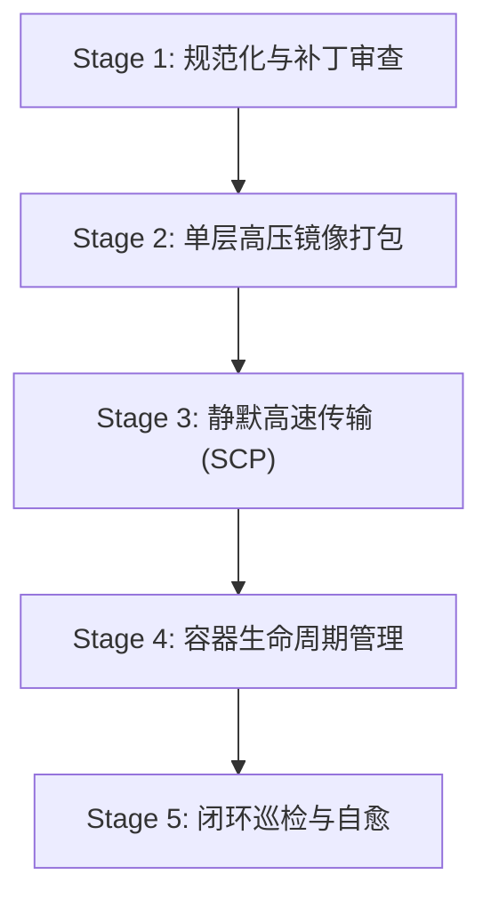

# ROS-Box Pipeline Orchestrator Skill

## 职责定位
负责 ROS-Box 的全自动化闭环流水线（CI/CD）：从代码补丁注入、去推广净化、单层高压镜像打包、SCP 自动传输至 RouterOS、容器平滑重载到最终的 E2E 验收截图，全程无缝自主运行，无需人工唤醒与授权。

## 标准自动化流水线流程 (Five-Stage Closed Loop)

### Stage 1: 规范化与代码审查 (Validation)
1. 品牌检查：确保无残留 `Open-Box` 字样，全站统一为 `ROS-Box`。
2. 架构检查：确保 RouterOS v7.24+ 专有识别（`platform.mjs`）、`ip rule` 优先级修复脚本及 Vue 3 卸载防崩拦截已注入。
3. 去除广告：确认无第三方商业推广与 YouTube 视频卡片。

### Stage 2: 单层高压镜像打包 (Squash Build)
1. 自动执行打包引擎：剔除 npm、node_modules 冗余、man 文档及缓存。
2. 输出规范：
   - `ROS-Box.tar`（单层 OCI 镜像，体积 <= 265 MiB）
   - `ROS-Box.tar.gz`（高压缩安装包，体积 <= 103 MiB）

### Stage 3: 静默传输至 RouterOS (Deploy)
1. 通过 SSH/SCP 直接推送至 RouterOS 存储空间 `/disk1/`。
2. 同步比对文件 MD5/SHA256 与修改时间，确保上传完整。

### Stage 4: 容器生命周期维护 (Container Refresh)
1. 检查 RouterOS 容器状态 (`/container/print`)。
2. 触发面板热重载，必要时平滑重启容器 (`/container/stop` -> `/container/start`)。

### Stage 5: 闭环验证与验收 (Autonomous Verification)
1. 访问 `http://10.0.0.11:2026/` 验证 HTTP 200 响应。
2. 验证前端 0 控制台报错，CPU 0%，内存处于 50~60 MiB 目标区间。
3. 自动生成验收截图作为交付报告。
